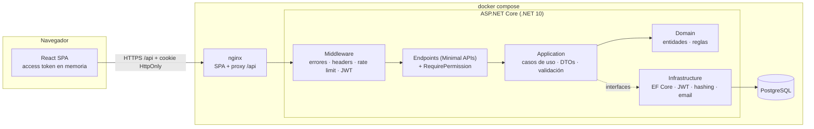

# usuarios-roles-base

> Plantilla base **reutilizable** de autenticación y autorización: registro con verificación de email, JWT de vida corta + refresh token rotativo con detección de reuso, recuperación de contraseña, bloqueo por intentos fallidos, **RBAC con permisos granulares**, auditoría de seguridad y panel de administración.
>
> **.NET 10 (ASP.NET Core + EF Core) · React 18 + TypeScript + Tailwind · PostgreSQL · Docker**

[](https://github.com/angel-cm-dev/usuarios-roles-base/actions/workflows/ci.yml)


Casi todos los sistemas empiezan por lo mismo: usuarios, login, roles y "quién puede hacer qué". Este repositorio resuelve esa base **una vez y bien**, con las prácticas de seguridad que suelen omitirse en los tutoriales, para que cualquier proyecto nuevo arranque desde aquí y se concentre en su dominio.

---

## Tabla de contenidos

- [Características](#características)
- [Arquitectura](#arquitectura)
- [Stack y justificación](#stack-y-justificación)
- [Inicio rápido con Docker](#inicio-rápido-con-docker-un-comando)
- [Inicio sin Docker](#inicio-sin-docker)
- [Credenciales demo](#credenciales-demo)
- [Endpoints principales](#endpoints-principales)
- [Pruebas](#pruebas)
- [Estructura de carpetas](#estructura-de-carpetas)
- [Variables de entorno](#variables-de-entorno)
- [Qué aprenderás con este proyecto](#qué-aprenderás-con-este-proyecto)
- [Cómo reutilizar esta plantilla](#cómo-reutilizar-esta-plantilla)
- [Roadmap](#roadmap)
- [Licencia y autor](#licencia-y-autor)

---

## Características

**Autenticación**
- Registro con **verificación de email** (token de un solo uso, 24 h). Envío simulado a un **buzón de desarrollo** (`/dev/buzon`) detrás de la interfaz `IEmailSender`.
- Login con **access token JWT de 15 min** (en memoria del navegador) + **refresh token opaco de 7 días** en cookie `HttpOnly; SameSite=Strict; Path=/api/auth`.
- **Rotación de refresh tokens con detección de reuso**: si se presenta un token ya rotado, se revoca **toda la familia** (sesión) y se audita.
- Logout (una sesión), **logout global** (todas las sesiones) y revocación de sesiones por un administrador.
- **Recuperación de contraseña** con token de un solo uso (se guarda solo su hash SHA-256, vence en 30 min). Al restablecerla se cierran todas las sesiones.
- **Política de contraseñas** configurable (longitud, mayúsculas, minúsculas, número, símbolo, lista de comunes, no contener el email) validada en backend y con **medidor de fortaleza** en el frontend.
- **Bloqueo de cuenta** tras 5 intentos fallidos (15 min, configurable).
- Respuestas **anti-enumeración** en registro y recuperación; tiempo de respuesta igualado cuando el email no existe.
- Hash de contraseñas con `PasswordHasher` de ASP.NET Core Identity (**PBKDF2-HMAC-SHA512, 100 000 iteraciones**, re-hash automático si cambian los parámetros).

**Autorización**
- **RBAC con permisos granulares** tipo `usuarios.leer`, `roles.editar`… Los permisos se asignan a roles y los roles a usuarios.
- **Autorización por política basada en permisos** con un `IAuthorizationPolicyProvider` dinámico: `.RequirePermission("usuarios.leer")` en cada endpoint (401 sin token, 403 sin permiso).
- Catálogo de permisos **en código**, sincronizado con la BD al arrancar (agregar un permiso = una línea).
- Reglas de negocio de seguridad: no se puede dejar el sistema sin administradores, ni bloquearse/desactivarse a uno mismo; el rol `admin` siempre tiene todos los permisos.

**Operación y calidad**
- **Auditoría** de eventos de seguridad (logins, bloqueos, reuso de tokens, cambios de roles/permisos…) con IP, user-agent y actor.
- **Rate limiting** por IP en login, registro y recuperación (`Microsoft.AspNetCore.RateLimiting`), respuesta 429 con `Retry-After`.
- **Cabeceras de seguridad** (CSP, `X-Frame-Options`, `nosniff`, `Referrer-Policy`, `Cache-Control: no-store` en la API, HSTS en producción).
- Errores **ProblemDetails (RFC 7807)** consistentes con `code` estable y `traceId`.
- Logging estructurado con **Serilog** (texto en desarrollo, JSON en producción).
- Listados con **paginación, búsqueda, filtros y orden**. `/health` con chequeo de BD. OpenAPI + **Scalar** en `/scalar`.
- **77 pruebas backend** (unitarias + integración con `WebApplicationFactory` y SQLite en memoria, **sin Docker**) y **41 pruebas frontend** (Vitest + Testing Library).

**Panel (React)**
- Login, registro, verificación de email, olvidé/restablecer contraseña, perfil y cambio de contraseña.
- Dashboard con KPIs (usuarios, bloqueados, sin verificar, sesiones activas, eventos y logins fallidos de 24 h, gráfico de 7 días).
- Tablas de **usuarios, roles, permisos y auditoría** con búsqueda, filtros, orden y paginación.
- **Acciones ocultas según permisos**, estados de carga/vacío/error, diseño responsive y **modo oscuro**.

---

## Arquitectura



Arquitectura en capas limpia: **Domain** no depende de nada; **Application** define casos de uso y contratos (`IApplicationDbContext`, `IEmailSender`, `IPasswordHasher`…); **Infrastructure** los implementa; **Api** compone todo. Detalle, flujo de una petición y diagramas de secuencia de los tokens en [`docs/arquitectura.md`](docs/arquitectura.md).

---

## Stack y justificación

| Capa | Tecnología | Por qué |
|------|------------|---------|
| API | ASP.NET Core 10 (Minimal APIs) | Rendimiento, tipado fuerte, autenticación/autorización y rate limiting de primera clase en el framework. |
| Persistencia | EF Core 10 + Npgsql | Migraciones versionadas, LINQ tipado y portable (PostgreSQL en producción, SQLite en pruebas). |
| Base de datos | PostgreSQL 16 | Robusta, libre, excelente soporte de `timestamptz` e índices. |
| Validación | FluentValidation | Reglas expresivas y testeables, separadas de los DTOs. |
| Seguridad | Identity `PasswordHasher`, JWT (`Microsoft.IdentityModel`) | Primitivas probadas en producción; nada de criptografía casera. |
| Logging | Serilog | Logs estructurados (JSON) listos para Loki/ELK/Seq. |
| Docs API | OpenAPI nativo de .NET 10 + Scalar | Documentación interactiva sin dependencias pesadas. |
| Pruebas | xUnit, WebApplicationFactory, SQLite en memoria, FakeTimeProvider | Integración real de la API sin Docker y control del tiempo para expiraciones. |
| Frontend | React 18 + Vite + TypeScript | Ecosistema maduro, build rápido, tipos compartidos con la API. |
| Estilos | Tailwind CSS 3 | Diseño consistente y modo oscuro con poco CSS propio. |
| Pruebas UI | Vitest + Testing Library | Mismo pipeline de Vite; pruebas centradas en el usuario. |
| Entrega | Docker multi-stage, nginx sin privilegios, GitHub Actions | Imágenes pequeñas, procesos no root y CI en cada push. |

> **Nota sobre .NET:** el proyecto apunta a **`net10.0`**. Se desarrolló y verificó con el SDK 10.0.402 (no hay runtime 8 instalado), por lo que no compila con SDKs anteriores. Las versiones NuGet están fijadas en [`backend/Directory.Packages.props`](backend/Directory.Packages.props).

---

## Inicio rápido con Docker (un comando)

Requisitos: Docker Desktop / Docker Engine con Compose v2.

```bash
cp .env.example .env        # opcional: valores de ejemplo ya vienen por defecto
docker compose up --build
```

| Servicio | URL |
|----------|-----|
| Panel (React vía nginx) | http://localhost:8080 |
| API directa + documentación Scalar | http://localhost:5080/scalar |
| Health check | http://localhost:8080/health |
| Buzón de desarrollo (correos simulados) | http://localhost:8080/dev/buzon |

La API aplica las **migraciones** de PostgreSQL y el **seed** al arrancar.

## Inicio sin Docker

Requisitos: **.NET SDK 10** y **Node 20+** (probado con Node 24 / npm 11). En desarrollo la API usa **SQLite** (archivo `usuarios-roles-dev.db`), así que no necesitas PostgreSQL.

**1. Backend** (http://localhost:5080):

```bash
cd backend
dotnet run --project src/UsuariosRoles.Api --launch-profile http
```

`appsettings.Development.json` ya trae una clave JWT **de ejemplo**, SQLite, buzón de desarrollo y cookie no `Secure` (http local). Documentación interactiva en http://localhost:5080/scalar.

> ¿Prefieres PostgreSQL local? Ejecuta con `Database__Provider=Postgres` y `ConnectionStrings__Default=Host=localhost;...`.

**2. Frontend** (http://localhost:5173):

```bash
cd frontend
npm install
npm run dev
```

Vite hace de proxy de `/api` hacia `http://localhost:5080` (cámbialo con `VITE_API_PROXY`), así la cookie `SameSite=Strict` funciona sin CORS.

---

## Credenciales demo

Datos **100 % ficticios**, creados por el seed (desactívalo con `Seed__DemoUsers=false`):

| Rol | Email | Contraseña | Puede |
|-----|-------|-----------|-------|
| admin | `admin@demo.pe` | `Demo123!` | Todo (catálogo completo de permisos) |
| usuario | `usuario@demo.pe` | `Demo123!` | Ver y editar su perfil (`perfil.editar`) |

Para probar el registro: crea una cuenta en `/registro`, abre `/dev/buzon` y pulsa el enlace de verificación.

---

## Endpoints principales

Todos bajo `/api`. Ejemplos con `curl` en [`docs/guia-api.md`](docs/guia-api.md).

| Método | Ruta | Acceso | Descripción |
|--------|------|--------|-------------|
| POST | `/auth/register` | Público · rate limit | Registro + correo de verificación (202, anti-enumeración) |
| POST | `/auth/verify-email` | Público · rate limit | Verifica el email con el token |
| POST | `/auth/resend-verification` | Público · rate limit | Reenvía la verificación |
| POST | `/auth/login` | Público · rate limit | Access token + cookie de refresh |
| POST | `/auth/refresh` | Cookie | Rota el refresh token (detecta reuso) |
| POST | `/auth/logout` | Cookie | Revoca la sesión actual |
| POST | `/auth/logout-all` | Autenticado | Revoca todas las sesiones |
| POST | `/auth/forgot-password` | Público · rate limit | Envía enlace de recuperación |
| POST | `/auth/reset-password` | Público · rate limit | Restablece con token de un solo uso |
| GET / PUT | `/auth/me` | Autenticado / `perfil.editar` | Perfil, roles y permisos efectivos |
| POST | `/auth/change-password` | Autenticado | Cambia contraseña y renueva la sesión |
| GET | `/users` | `usuarios.leer` | Lista paginada (`search`, `status`, `role`, `sortBy`, `sortDir`) |
| POST | `/users` | `usuarios.crear` | Crea usuario |
| PUT | `/users/{id}` | `usuarios.editar` | Edita nombre y estado |
| PUT | `/users/{id}/roles` | `usuarios.asignar-roles` | Asigna roles |
| POST | `/users/{id}/lock` · `/unlock` · `/revoke-sessions` | `usuarios.bloquear` | Bloqueo y sesiones |
| GET / POST / PUT / DELETE | `/roles` | `roles.*` | CRUD de roles |
| PUT | `/roles/{id}/permissions` | `roles.editar` | Permisos del rol |
| GET | `/permissions` · `/permissions/modules` | `permisos.leer` | Catálogo de permisos |
| GET | `/audit` · `/audit/event-types` | `auditoria.leer` | Auditoría (`eventType`, `succeeded`, `from`, `to`…) |
| GET | `/dashboard/stats` | `dashboard.ver` | KPIs del panel |
| GET / DELETE | `/dev/mailbox` | Solo si `Features:DevMailbox` | Buzón de desarrollo |
| GET | `/health` | Público | Estado de la API y la BD |

---

## Pruebas

```bash
# Backend: 48 unitarias + 29 de integración (SQLite en memoria, sin Docker)
cd backend
dotnet test

# Frontend: 41 pruebas (Vitest + Testing Library), lint y build
cd frontend
npm test
npm run lint
npm run build
```

Qué se prueba:

- **Unitarias**: política de contraseñas, bloqueo por intentos, rotación de refresh tokens y **revocación de la familia ante reuso**, tokens de un solo uso (expiración, propósito, consumo concurrente con token de concurrencia), handler y proveedor de políticas de permisos, generación/hash de tokens, hasher de contraseñas.
- **Integración** (API real en memoria): registro → verificación → login → refresh → **reuso detectado** (401 + familia revocada + auditoría); 401/403 por permisos; permisos nuevos aplicados tras refresh; bloqueo tras 5 intentos (423); recuperación de contraseña de un solo uso; logout; cambio de contraseña; reglas "último admin"; rate limiting (429); cabeceras de seguridad; ProblemDetails.
- **Frontend**: medidor de fortaleza, validaciones, cliente HTTP (refresh automático ante 401, *single-flight*, mapeo de ProblemDetails), `<Can>` (ocultar acciones), paginación y página de login.

El CI ([`.github/workflows/ci.yml`](.github/workflows/ci.yml)) ejecuta formato, build, pruebas y verificación de migraciones en el backend; lint, pruebas y build en el frontend.

---

## Estructura de carpetas

```
usuarios-roles-base/
├── backend/
│   ├── Directory.Build.props        # net10.0, nullable, etc. para todos los proyectos
│   ├── Directory.Packages.props     # versiones NuGet centralizadas y fijadas
│   ├── dotnet-tools.json            # dotnet-ef local (migraciones)
│   ├── Dockerfile                   # multi-stage, usuario no root
│   ├── scripts/schema-postgres.sql  # esquema SQL generado desde las migraciones (idempotente)
│   ├── src/
│   │   ├── UsuariosRoles.Domain/         # Entidades (User, Role, RefreshToken…), catálogo de permisos, reglas
│   │   ├── UsuariosRoles.Application/    # Casos de uso (AuthService, UserService…), DTOs, validadores, interfaces
│   │   ├── UsuariosRoles.Infrastructure/ # EF Core, migraciones, seed, JWT, hashing, buzón de email
│   │   └── UsuariosRoles.Api/            # Program.cs, endpoints, autorización por permisos, middleware
│   └── tests/
│       ├── UsuariosRoles.UnitTests/        # Lógica de negocio y seguridad
│       └── UsuariosRoles.IntegrationTests/ # API completa con WebApplicationFactory
├── frontend/
│   ├── src/
│   │   ├── api/          # cliente HTTP (tokens, refresh, errores) y servicios por recurso
│   │   ├── auth/         # AuthContext, guards (RequireAuth, RequirePermission, <Can>), permisos
│   │   ├── components/   # UI reutilizable (DataTable, Modal, PasswordStrengthMeter…) y layouts
│   │   ├── hooks/        # usePagedQuery (paginación/filtros/orden), useTheme
│   │   ├── lib/          # validación, fortaleza de contraseña, formato
│   │   └── pages/        # pantallas (auth, dashboard, usuarios, roles, permisos, auditoría, perfil)
│   ├── nginx.conf        # SPA + proxy /api + cabeceras de seguridad
│   └── Dockerfile        # build + nginx sin privilegios
├── docs/
│   ├── arquitectura.md · modelo-datos.md · guia-api.md · reutilizar-plantilla.md
│   └── decisiones/       # ADRs
├── docker-compose.yml · .env.example · .github/workflows/ci.yml
└── LICENSE · README.md
```

---

## Variables de entorno

La API usa la configuración estándar de .NET: cualquier clave de `appsettings.json` se sobrescribe con una variable de entorno usando `__` (p. ej. `Jwt__Key`).

| Variable (API) | Por defecto | Descripción |
|----------------|-------------|-------------|
| `Database__Provider` | `Postgres` (`Sqlite` en Development) | Proveedor de BD |
| `ConnectionStrings__Default` | PostgreSQL local | Cadena de conexión |
| `Jwt__Key` | — (**obligatoria**, ≥ 32 bytes) | Clave HMAC del JWT. La API no arranca sin ella |
| `Jwt__Issuer` / `Jwt__Audience` | `usuarios-roles-base` / `…-clients` | Emisor y audiencia |
| `Jwt__AccessTokenMinutes` | `15` | Vida del access token (1–60) |
| `AuthCookie__Secure` | `true` | Cookie solo por HTTPS (false solo en http local) |
| `Security__Lockout__MaxFailedAttempts` / `LockoutMinutes` | `5` / `15` | Bloqueo de cuenta |
| `Security__Password__MinLength` (y `Require*`) | `8` | Política de contraseñas |
| `Security__Tokens__RefreshTokenDays` | `7` | Vida del refresh token |
| `Security__Tokens__EmailVerificationHours` / `PasswordResetMinutes` | `24` / `30` | Vida de tokens de un solo uso |
| `RateLimiting__AuthPermitLimit` / `AuthWindowSeconds` | `10` / `60` | Rate limit por IP en endpoints de auth |
| `AppUrls__FrontendBaseUrl` | `http://localhost:5173` | Base de los enlaces de los correos |
| `Cors__AllowedOrigins__0` | — | Solo si el frontend está en otro origen |
| `ReverseProxy__TrustAllProxies` | `false` | Confiar en `X-Forwarded-For` (true detrás de nginx) |
| `Features__DevMailbox` | `false` (`true` en Development) | Expone `/api/dev/mailbox` |
| `OpenApi__Enabled` | `false` (siempre on en Development) | Expone `/openapi` y `/scalar` |
| `Seed__DemoUsers` | `true` | Crea usuarios demo ficticios |

En Docker se configuran desde `.env` (ver [`.env.example`](.env.example)). Frontend: `VITE_API_BASE_URL` (por defecto `/api`), `VITE_API_PROXY` (solo dev) y `VITE_SHOW_DEV_MAILBOX`.

---

## Qué aprenderás con este proyecto

- Diseñar **arquitectura en capas limpia** en .NET y por qué Application define interfaces que Infrastructure implementa.
- Implementar **JWT de vida corta + refresh tokens rotativos** y entender por qué la **detección de reuso** revoca la familia completa.
- Guardar **solo hashes** de tokens y contraseñas, y elegir el algoritmo adecuado para cada caso (PBKDF2 vs SHA-256).
- Construir **autorización por permisos** con un `IAuthorizationPolicyProvider` dinámico en lugar de comprobar roles "a mano".
- Proteger endpoints sensibles con **rate limiting**, bloqueo de cuentas, respuestas **anti-enumeración** y cabeceras de seguridad.
- Usar **tokens de concurrencia** de EF Core para garantizar el "un solo uso" bajo peticiones simultáneas.
- Escribir **pruebas de integración reales** con `WebApplicationFactory` y SQLite en memoria (sin Docker) y controlar el tiempo con `FakeTimeProvider`.
- Gestionar el access token **en memoria** en React, el **refresh automático ante 401** y por qué debe ser *single-flight*.
- Ocultar acciones según permisos en la UI **sin confiar en ello** como medida de seguridad.
- Empaquetar con **Docker multi-stage** y usuarios no root, y automatizar con **GitHub Actions**.

---

## Cómo reutilizar esta plantilla

Guía completa paso a paso en [`docs/reutilizar-plantilla.md`](docs/reutilizar-plantilla.md). En resumen:

1. **Renombra** la solución y namespaces (`UsuariosRoles` → `MiProyecto`), la cookie y el título del panel.
2. **Agrega permisos**: una constante en `Domain/Security/Permissions.cs` + su entrada en `All` + `.RequirePermission(...)` en el endpoint + la misma clave en `frontend/src/auth/permissions.ts`. El seed la crea y se la da al rol `admin`.
3. **Agrega módulos**: entidad en Domain → servicio + DTOs + validadores en Application → `DbSet` + configuración + migración en Infrastructure → endpoints en Api → página en el frontend.
4. **Cambia `IEmailSender`** por SMTP real (ejemplo con MailKit incluido) y desactiva `Features:DevMailbox`.
5. **Producción**: clave JWT propia, `AuthCookie__Secure=true` con HTTPS, `Seed__DemoUsers=false`, `OpenApi__Enabled` según política.

---

## Roadmap

- [ ] Autenticación de dos factores (TOTP) y códigos de recuperación.
- [ ] Inicio de sesión con proveedores externos (OpenID Connect: Google, Microsoft).
- [ ] Periodo de gracia configurable en la rotación de refresh tokens (pestañas concurrentes) y vida máxima absoluta de la familia.
- [ ] Vista de "mis sesiones activas" con revocación por dispositivo.
- [ ] Invalidación inmediata de access tokens (sello de seguridad por usuario) al cambiar roles o bloquear.
- [ ] Comprobación de contraseñas filtradas con la API *k-anonymity* de Have I Been Pwned.
- [ ] Envío de correos en segundo plano con cola y reintentos (outbox).
- [ ] Rate limiting distribuido (Redis) para despliegues con varias réplicas.
- [ ] Pruebas E2E con Playwright.

---

## Licencia y autor

Distribuido bajo licencia **MIT** — ver [`LICENSE`](LICENSE).

**Angel Castañeda Meza** — Ingeniero de Sistemas · Lima, Perú
GitHub: [@angel-cm-dev](https://github.com/angel-cm-dev)
