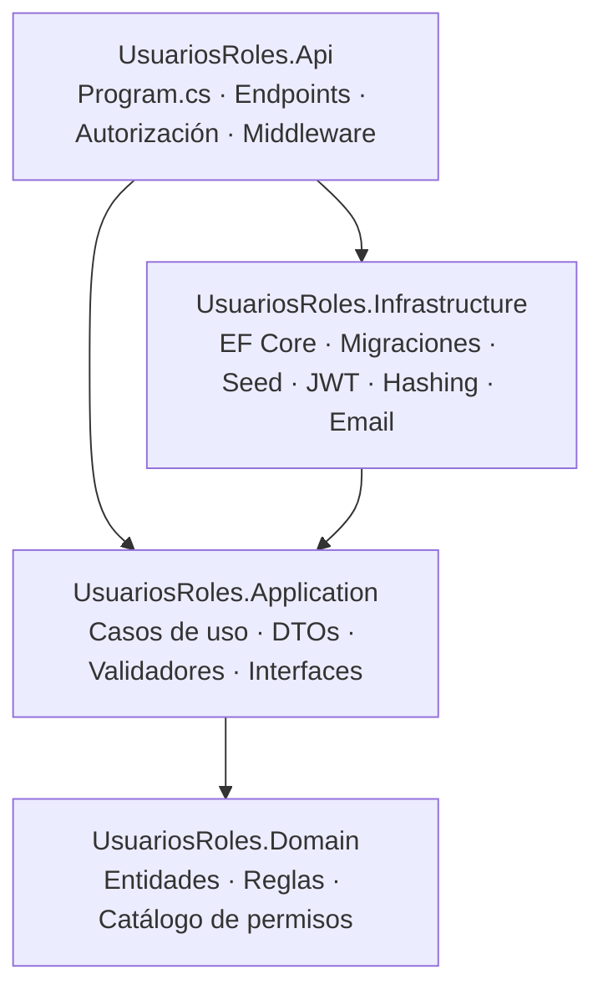
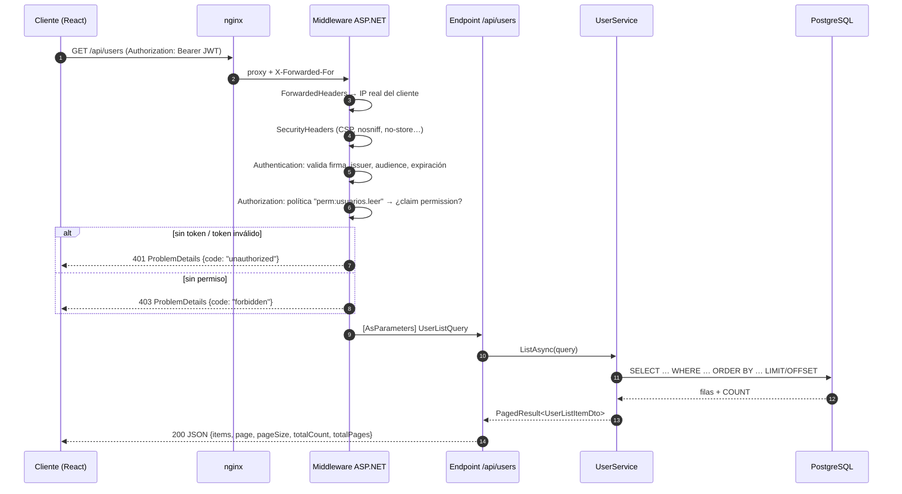
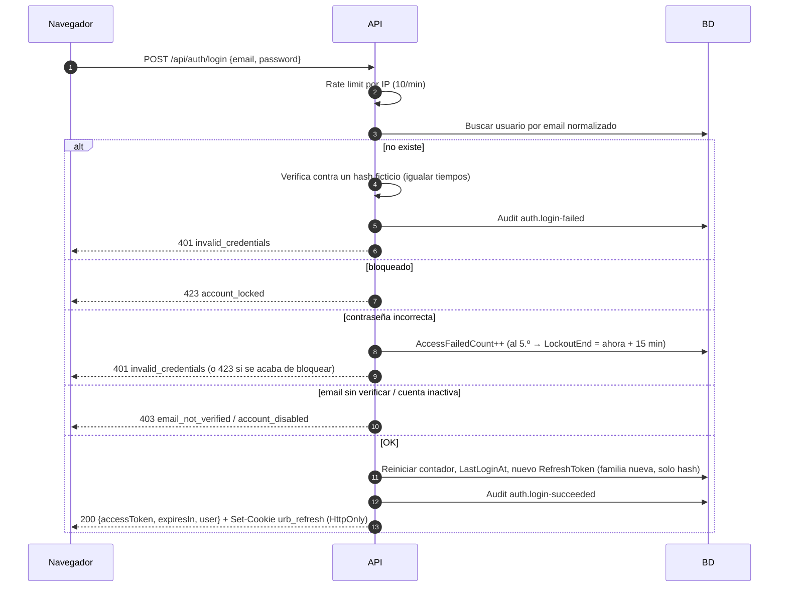
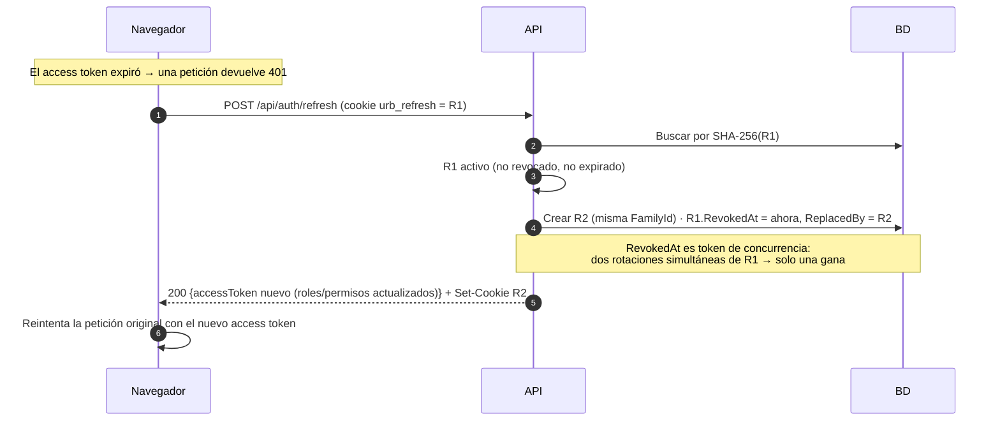
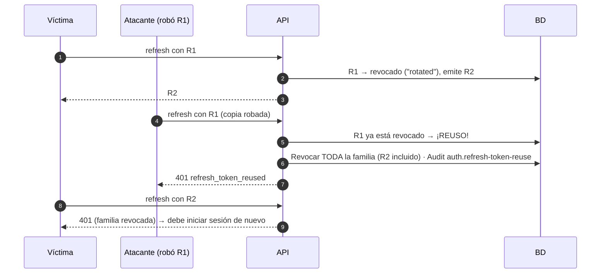
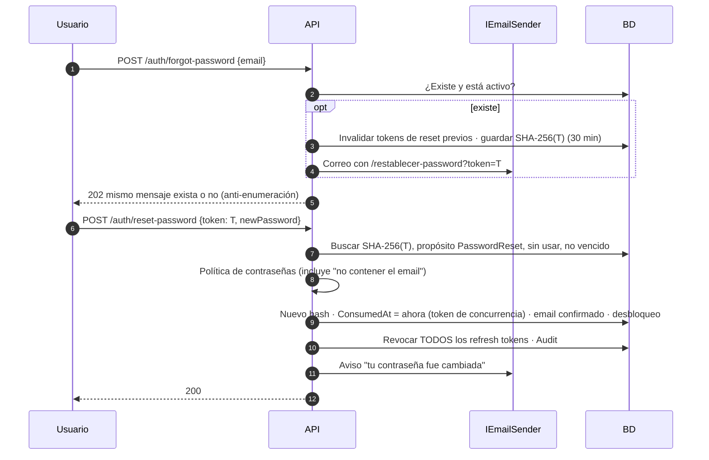
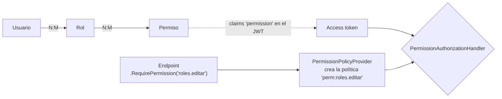
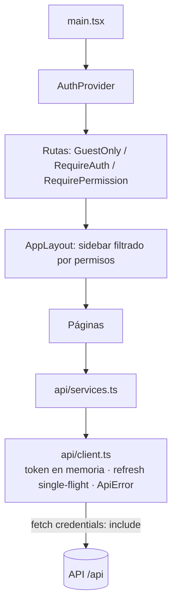
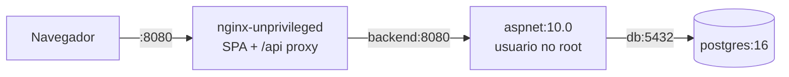

# Arquitectura

Este documento explica **cómo está organizado** el sistema, **cómo viaja una petición** y **cómo funcionan los tokens**. Está pensado para que puedas modificar la plantilla con seguridad.

## 1. Capas del backend



La regla de dependencias es: **las flechas apuntan hacia el dominio**. El dominio no conoce EF Core ni ASP.NET Core.

| Capa | Responsabilidad | Ejemplos |
|------|-----------------|----------|
| **Domain** | Entidades con sus invariantes. Sin dependencias. | `User.RegisterFailedLogin()` decide cuándo bloquear; `RefreshToken.Revoke()` es idempotente; `UserToken.TryConsume()` garantiza un solo uso; `Permissions` es el catálogo. |
| **Application** | Orquesta casos de uso. Define **puertos** (interfaces) que necesita. | `AuthService`, `RefreshTokenService`, `UserService`, `RoleService`; `IApplicationDbContext`, `IEmailSender`, `IPasswordHasher`, `IAccessTokenGenerator`, `IRequestContext`; validadores FluentValidation; `PasswordPolicy`. |
| **Infrastructure** | Implementa los puertos con tecnología concreta. | `AppDbContext` (EF Core, snake_case, fechas UTC), migraciones PostgreSQL, `DataSeeder`, `JwtAccessTokenGenerator`, `IdentityPasswordHasher`, `SecureTokenGenerator`, `DevMailboxEmailSender`. |
| **Api** | Composición (DI) y HTTP. | Minimal APIs por módulo, `RequirePermission`, `PermissionPolicyProvider`, `GlobalExceptionHandler`, `ValidationFilter`, `SecurityHeadersMiddleware`, rate limiting, Serilog, OpenAPI. |

**¿Por qué Application usa `DbSet` a través de `IApplicationDbContext`?** Es un compromiso pragmático: evitamos un repositorio genérico que solo reenvía llamadas a EF Core, pero Application sigue sin conocer el proveedor (PostgreSQL/SQLite) ni el `DbContext` concreto. Las pruebas unitarias usan el mismo contexto sobre SQLite en memoria.

## 2. Flujo de una petición

Ejemplo: `GET /api/users?search=ana&status=locked` con un access token válido.



Orden del pipeline (en `Program.cs`, **el orden importa**):

1. `UseForwardedHeaders` — antes que todo, para que el rate limiting y la auditoría vean la IP real.
2. `UseExceptionHandler` + `UseStatusCodePages` — toda excepción o respuesta de error vacía sale como ProblemDetails.
3. `SecurityHeadersMiddleware` y HSTS (fuera de Development).
4. `UseSerilogRequestLogging` — una línea estructurada por petición.
5. `UseCors` → `UseAuthentication` → `UseAuthorization` → `UseRateLimiter`.

Los errores de negocio se lanzan como excepciones tipadas (`NotFoundException`, `ConflictException`, `BusinessRuleException`, `AccountLockedException`, `RequestValidationException`…) y el `GlobalExceptionHandler` las traduce a un único formato:

```json
{
  "type": "https://tools.ietf.org/html/rfc9110#section-15.5.1",
  "title": "Datos inválidos",
  "status": 400,
  "detail": "Uno o más campos no son válidos.",
  "code": "validation_error",
  "errors": { "password": ["Debe incluir al menos un número."] },
  "traceId": "0HN…",
  "instance": "/api/auth/register"
}
```

## 3. Tokens: diseño

| Token | Formato | Vida | Dónde vive | Qué se guarda en BD |
|-------|---------|------|-----------|---------------------|
| Access token | JWT HS256 con `sub`, `email`, `name`, `role[]`, `permission[]`, `jti` | 15 min | **Memoria** del navegador (variable JS) | Nada (es autocontenido) |
| Refresh token | Opaco, 256 bits aleatorios (Base64Url) | 7 días, rota en cada uso | Cookie `HttpOnly; SameSite=Strict; Path=/api/auth` | SHA-256 del valor + familia + estado |
| Verificación de email | Opaco, 256 bits | 24 h, un solo uso | Enlace en el correo | SHA-256 + propósito + `ConsumedAt` |
| Recuperación de contraseña | Opaco, 256 bits | 30 min, un solo uso | Enlace en el correo | SHA-256 + propósito + `ConsumedAt` |

¿Por qué SHA-256 y no PBKDF2 para los tokens? Porque son **aleatorios y largos** (256 bits): no se pueden adivinar por diccionario, así que no necesitan un hash lento. Las contraseñas, que sí son adivinables, usan PBKDF2 con 100 000 iteraciones.

### 3.1 Login



Los chequeos de "email sin verificar" y "cuenta inactiva" van **después** de validar la contraseña: así no revelan el estado de una cuenta a quien no conoce la contraseña.

### 3.2 Refresh con rotación



El cliente hace la renovación **single-flight**: si varias peticiones reciben 401 a la vez, todas esperan **una sola** llamada a `/refresh` (y entre pestañas se serializa con la Web Locks API). Si no, el navegador enviaría R1 dos veces y el servidor lo interpretaría como reuso.

### 3.3 Detección de reuso



No podemos saber quién es el legítimo, así que se corta la sesión para ambos. El usuario real vuelve a autenticarse; el atacante, sin la contraseña, ya no puede. Si el atacante usara R1 **antes** que la víctima, ocurre lo mismo en el siguiente refresh de la víctima.

### 3.4 Recuperación de contraseña



## 4. Autorización por permisos



- `RequirePermission("x")` registra la política `perm:x` en el endpoint (y falla al arrancar si `x` no está en el catálogo).
- `PermissionPolicyProvider` crea esa política al vuelo: requiere usuario autenticado + `PermissionRequirement("x")`.
- `PermissionAuthorizationHandler` comprueba el claim `permission` del JWT.

Los permisos viajan en el JWT (sin consulta a BD por petición). Un cambio de roles/permisos se aplica **en la siguiente renovación** del access token (≤ 15 min). Ver [ADR 0002](decisiones/0002-permisos-en-el-jwt.md).

## 5. Frontend



- **`api/client.ts`**: adjunta el access token, ante 401 intenta un refresh y reintenta una vez; convierte ProblemDetails en `ApiError` (con `code` y errores por campo).
- **`AuthContext`**: al cargar la app intenta recuperar la sesión con la cookie (el access token no sobrevive a un F5 porque vive en memoria, a propósito).
- **`<Can permission>` / `RequirePermission`**: ocultan acciones y rutas. Es solo UX: la API valida siempre.
- **`usePagedQuery`**: estado de tablas (página, tamaño, búsqueda con debounce, filtros, orden) con cancelación de peticiones obsoletas (`AbortController`).

## 6. Despliegue



- La API corre como el usuario sin privilegios `$APP_UID` de la imagen oficial; nginx usa la variante *unprivileged*.
- La API aplica migraciones y seed al arrancar (idempotente). Para entornos con varias réplicas conviene aplicar migraciones en un paso previo del pipeline usando `backend/scripts/schema-postgres.sql` o `dotnet ef database update`.
