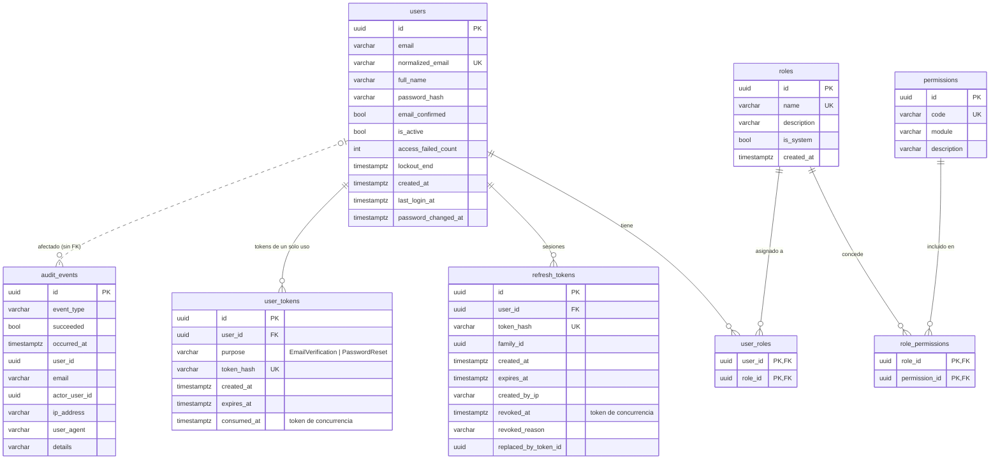

# Modelo de datos

Esquema relacional en PostgreSQL (tablas y columnas en `snake_case`). Generado por EF Core a partir de las configuraciones de `Infrastructure/Persistence/Configurations.cs`. El SQL completo está en [`backend/scripts/schema-postgres.sql`](../backend/scripts/schema-postgres.sql).



## Tablas

### `users`
Cuenta de usuario. `normalized_email` (mayúsculas) tiene **índice único**: evita duplicados que solo difieren en mayúsculas sin depender de la *collation* de la BD. `password_hash` guarda el formato v3 de ASP.NET Core Identity (incluye algoritmo, iteraciones y sal). El bloqueo se modela con `access_failed_count` + `lockout_end`: la cuenta está bloqueada mientras `lockout_end > ahora`.

### `roles`
Agrupación de permisos. `name` es único, en minúsculas, y viaja como claim `role` en el JWT. `is_system = true` para `admin` y `usuario`: no se pueden renombrar ni eliminar.

### `permissions`
Catálogo de permisos `modulo.accion`. **La fuente de verdad es el código** (`Domain/Security/Permissions.cs`); el seed sincroniza esta tabla en cada arranque (agrega nuevos y actualiza descripciones).

### `user_roles` y `role_permissions`
Tablas puente N:M con clave primaria compuesta. Borrar un usuario borra sus asignaciones (cascade); borrar un rol con usuarios está **restringido** en la BD (y la app lo valida antes con un mensaje claro). Borrar un rol sí elimina sus `role_permissions`.

### `refresh_tokens`
Una fila por refresh token emitido. Solo se guarda `token_hash` (SHA-256 en hex, índice único). Todos los tokens de una misma sesión comparten `family_id` (índice) para poder revocar la cadena entera ante un reuso. `replaced_by_token_id` permite reconstruir la cadena de rotación. `revoked_at` es **token de concurrencia**: si dos peticiones intentan rotar el mismo token a la vez, el `UPDATE … WHERE revoked_at IS NULL` de la segunda no afecta filas y EF Core lanza `DbUpdateConcurrencyException`.

Índices: `token_hash` (único), `family_id`, `(user_id, revoked_at)` para contar/revocar sesiones activas de un usuario.

### `user_tokens`
Tokens de un solo uso (verificación de email y recuperación de contraseña). `purpose` se guarda como texto legible. `consumed_at` marca el uso y es token de concurrencia (dos clics simultáneos en el mismo enlace → solo uno gana). Al emitir un token nuevo se invalidan los pendientes del mismo propósito.

### `audit_events`
Registro *append-only* de eventos de seguridad. **No tiene FK a `users`** a propósito: la auditoría debe sobrevivir aunque el usuario se elimine, y también registra intentos con emails inexistentes. `user_id` es el afectado y `actor_user_id` quien ejecutó la acción (p. ej. el admin que bloqueó). Índices en `occurred_at`, `(event_type, occurred_at)` y `user_id` para los filtros del panel.

Tipos de evento (columna `event_type`): ver `Domain/Security/AuditEventTypes.cs` (`auth.login-succeeded`, `auth.login-failed`, `auth.account-locked`, `auth.refresh-token-reuse`, `admin.role-permissions-changed`, …).

## Fechas

Todas las fechas se manejan en **UTC** (`timestamptz` en PostgreSQL). Un `ValueConverter` en `AppDbContext` marca como UTC las fechas leídas (SQLite no conserva el *Kind*), así la API siempre serializa con `Z` y el frontend las convierte a la hora local.

## Datos semilla

| Qué | Detalle |
|-----|---------|
| Permisos | Todo el catálogo de `Permissions.All` (13 permisos). |
| Rol `admin` | Sistema. Siempre recibe **todos** los permisos (también los que agregues después). |
| Rol `usuario` | Sistema. Rol por defecto en el registro. Nace con `perfil.editar`. |
| `admin@demo.pe` / `Demo123!` | Rol admin, email verificado. Ficticio. |
| `usuario@demo.pe` / `Demo123!` | Rol usuario, email verificado. Ficticio. |

## Migraciones

```bash
cd backend
dotnet tool restore
# Crear una migración tras cambiar el modelo
dotnet tool run dotnet-ef migrations add NombreDelCambio --project src/UsuariosRoles.Infrastructure --startup-project src/UsuariosRoles.Infrastructure --output-dir Persistence/Migrations
# Regenerar el script SQL idempotente
dotnet tool run dotnet-ef migrations script --idempotent --project src/UsuariosRoles.Infrastructure --startup-project src/UsuariosRoles.Infrastructure -o scripts/schema-postgres.sql
```

Con PostgreSQL la API aplica las migraciones al arrancar (`Database.MigrateAsync`). Con SQLite (desarrollo sin Docker y pruebas) se usa `EnsureCreated`, porque las migraciones son específicas de PostgreSQL. Ver [ADR 0003](decisiones/0003-postgresql-y-sqlite-en-pruebas.md).
